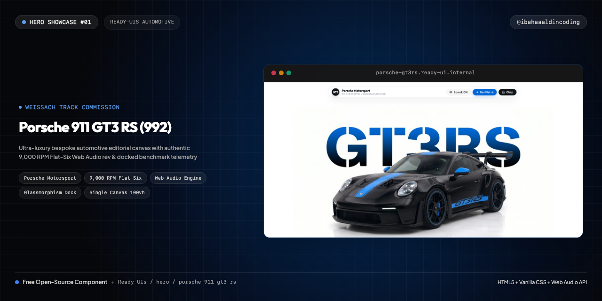
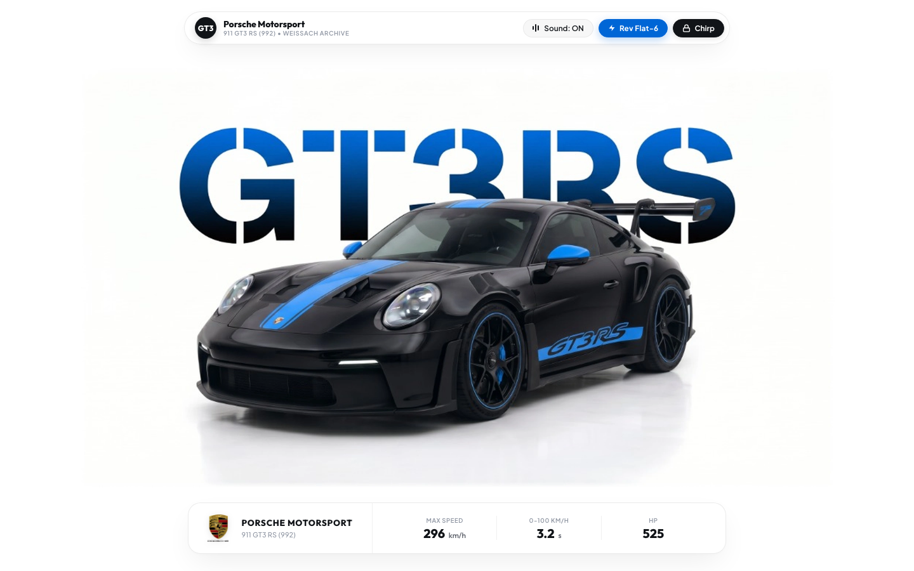
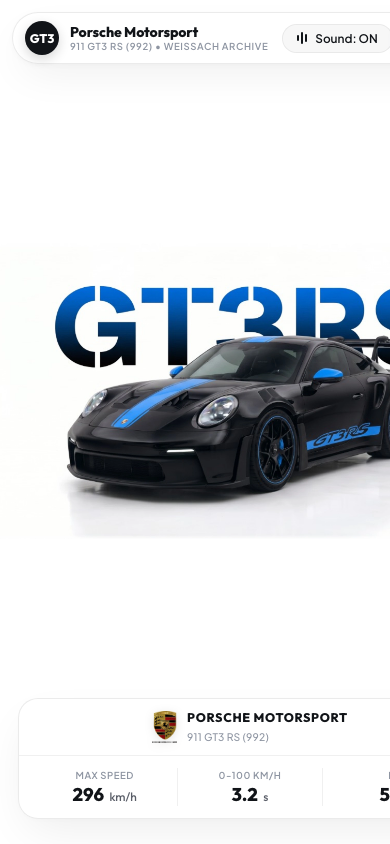

# 🏎️ Porsche 911 GT3 RS (992) — Bespoke Automotive Editorial Showcase

> High-craft automotive editorial canvas engineered with pure HTML5, vanilla CSS, and real-time Web Audio API 9,000 RPM Flat-Six Boxer engine synthesis featuring benchmark telemetry and interactive keyfob chirp.

[](https://ibahaaaldin.github.io/hero-porsche-911-gt3-rs/)
[](https://ibahaaaldin.github.io/hero-porsche-911-gt3-rs/)

---

## 🌐 Visual Previews

| Cover Preview | Desktop Showcase Preview | Mobile View |
| :---: | :---: | :---: |
| [](https://ibahaaaldin.github.io/hero-porsche-911-gt3-rs/) | [](https://ibahaaaldin.github.io/hero-porsche-911-gt3-rs/) | [](https://ibahaaaldin.github.io/hero-porsche-911-gt3-rs/) |

---

## ⚡ Machine Telemetry

| Benchmark Metric | Specification Value |
| :--- | :--- |
| **Powertrain** | `4.0L Naturally Aspirated Boxer-6` |
| **Peak Output** | `525 HP (386 kW) @ 8,500 RPM` |
| **Peak Torque** | `465 Nm @ 6,300 RPM` |
| **Max Engine Speed** | `9,000 RPM` |
| **0–100 km/h** | `3.2 s` |
| **Top Velocity** | `296 km/h` |
| **Aero Downforce** | `860 kg @ 285 km/h (Active DRS)` |
| **Transmission** | `7-Speed Porsche Doppelkupplung (PDK)` |

---

## ✨ Features & Micro-Interactions

- **Editorial 100vh Canvas**: Pristine minimalist white studio aesthetic with high-impact "GT3RS" stencil typography and Weissach Blue vehicle staging.
- **Official Brand Crest**: Authentic high-resolution Porsche crest emblem with locked interactions.
- **Docked Spec Pill**: Segmented benchmark performance telemetry card displaying Max Speed (296 km/h), Acceleration (3.2 s), and Horsepower (525 HP).
- **Real-time Web Audio API Engine**:
  - Authentic 9,000 RPM naturally-aspirated Flat-Six mechanical howl synthesis with firing order pulses, harmonic distortion, and overrun exhaust pops.
  - Interactive Remote Keyfob chirp with dual acoustic frequency lock (`2,400 Hz` to `3,200 Hz`).
- **Zero Build Dependencies**: Pure HTML5, vanilla CSS, and modular ES6 JavaScript. Runs instantly in any modern browser without `npm install`.
- **Responsive Ergonomics**: Pixel-perfect layout across desktop displays (`1440x900`+) and mobile screens (`390x844`).

---

## 📁 Repository Structure

```text
hero-porsche-911-gt3-rs/
├── index.html              # Main bespoke automotive editorial showcase
├── styles.css              # High-craft styles, animations & glassmorphism
├── script.js               # Web Audio API engine & interactive controller
├── cover.png               # Widescreen cover banner (1280x640)
├── cover-instagram.png     # Square post cover (1080x1080)
├── cover-reel.png          # Vertical reel cover (1080x1920)
├── screenshot-desktop.png  # High-res desktop preview
├── screenshot-mobile.png   # High-res mobile preview
├── assets/
│   ├── images/             # Ultra-HD WebP artwork & cutouts
│   ├── icons/              # Official crests & brand vectors
│   └── audio/              # Studio recordings & sound profiles
├── README.md               # Telemetry specs & documentation
└── CAPTION.md              # Ready-to-copy social media caption
```

---

## 🚀 Quick Start

### 1. View Locally
Simply open `index.html` in your browser:
```bash
open index.html
```

### 2. Live Demo
Visit the live interactive deployment on GitHub Pages:
**[https://ibahaaaldin.github.io/hero-porsche-911-gt3-rs/](https://ibahaaaldin.github.io/hero-porsche-911-gt3-rs/)**

---

## 👤 Author & Connect

**Bahaa Mohammed**  
*Creative Developer & Software Engineer*  

- 📸 **Instagram**: [@ibahaaaldincoding](https://www.instagram.com/ibahaaaldincoding)  
- 🐙 **GitHub**: [@IBahaaaldin](https://github.com/IBahaaaldin)  
- 💼 **LinkedIn**: [Bahaa Mohammed](https://www.linkedin.com/in/bahaa-mohammed-371259369)  
- 📧 **Email**: [bahaam.coding@gmail.com](mailto:bahaam.coding@gmail.com)  

---

## 📄 License

MIT © [Bahaa Mohammed](https://github.com/IBahaaaldin/hero-porsche-911-gt3-rs)
